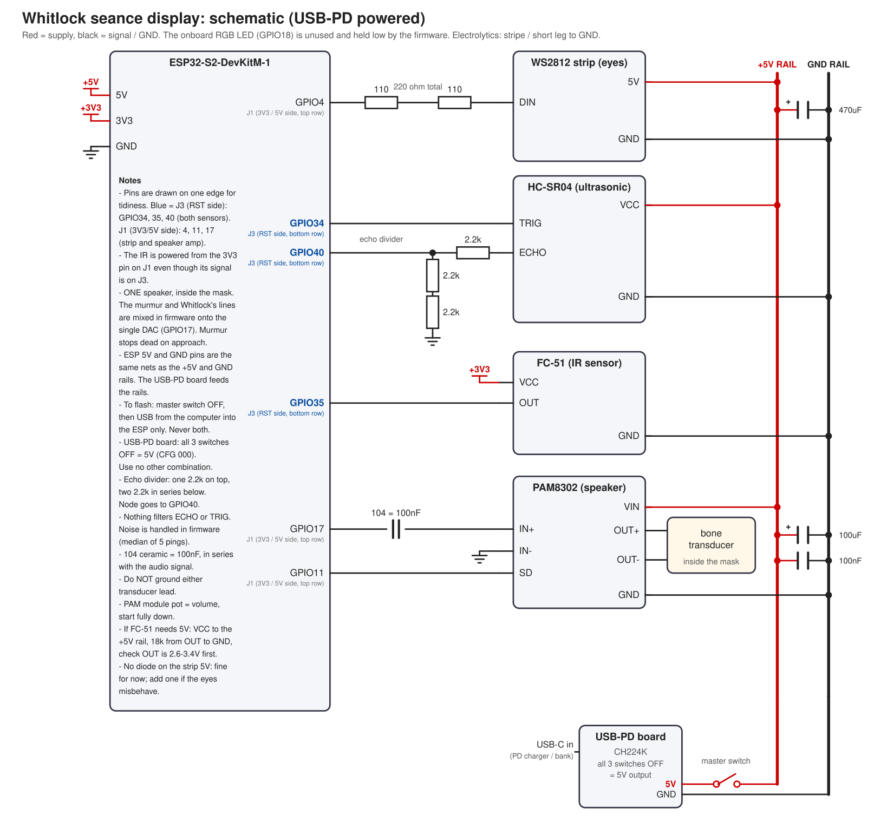

# Whitlock

A Halloween library séance display: a hollow 3D-printed mask that murmurs, watches with candle-glow eyes, and reacts to how close you stand. It runs on one ESP32-S2 with no wifi, no SD card and nothing that moves.


- **It notices you before you notice it.** At about 1 m the eyes slowly brighten, at 50 cm the murmur ducks and the flicker stops, and under 20 cm the whispers cut dead and the eyes go dark
- **The murmur is synthesised on the chip.** A crowd of whisperers that never loops, with no audio files and no flash used
- **Whitlock speaks.** A random line from a pool plays when someone walks away, and another when a book is placed in the empty seat
- **Candle-glow eyes.** Per-eye random flicker with its own temporal dithering, so the dim end stays smooth and amber
- **Doesn't sit dead at lunch.** If someone lingers for two minutes, it does the odd glint or quiet sigh to keep them there
- **Self-contained.** One speaker inside the mask, powered by a single USB-C PD supply
- **One config file**, with a switch for the Friday look

This is the firmware and build notes for one installation, shared as-is. The story it tells: the mask is Whitlock, a 1926 borrower who never returned *Catalogue of Persons, Vol. II* (027.8 WHI), and the murmur is the collected borrowers.

## Quick Start

You need the parts below, [PlatformIO](https://platformio.org/) and a USB cable. Developed on Fedora Linux. PlatformIO also runs on macOS and Windows, but that hasn't been tried here.

**1. Gather the parts**

| Part | Notes |
|---|---|
| ESP32-S2-DevKitM-1 | 4 MB flash. Its onboard RGB LED (GPIO18) is unused: the firmware holds that pin low |
| WS2812 strip, 8 LEDs | 4 per eye, inside the mask |
| HC-SR04 ultrasonic | in the base, aimed straight out |
| FC-51 IR obstacle sensor | hidden in the empty seat, tuned to about 8-10 cm |
| PAM8302 amp module + bone-conduction transducer | inside the mask |
| USB-C PD trigger board (CH224K) | **all three switches off = 5 V**, check with a multimeter |
| Passives | 2 x 110 ohm (strip data), 3 x 2.2k (echo divider), 100 nF "104" ceramic (audio coupling), 470 uF + 100 nF across the strip, 100 uF + 100 nF across the amp |
| A master switch | in the 5 V feed |

**2. Install PlatformIO**

Either the VS Code extension or the CLI. The first build downloads the toolchain, which takes a few minutes. On Linux, let your user open the serial port, then log out and back in:

```bash
sudo usermod -aG dialout $USER
```

**3. Get the code**

```bash
git clone <this repo's URL>
cd Halloween
```

**4. Build the hardware**

Follow [Wiring](#wiring). Test it on the bench before it goes in the mask: with the repo's default `TEST_MODE 1`, every timer is squeezed so each behaviour fires within seconds.

**5. Add your audio**

Put your clips in `audio/notthat/` and `audio/reaction/` (see [Audio](#audio)), then:

```bash
python3 tools/wav2c.py
```

Until you do, the build uses synthesised placeholder beeps and breaths.

**6. Set the flags for the install**

In [src/config.h](src/config.h):

- `TEST_MODE` to `0` (real timings)
- `DEBUG_LOG` to `0` (no serial chatter)
- `FRIDAY_MODE` to `0` for Monday to Thursday, `1` for Friday

**7. Upload**

With the **master switch off** and USB from the computer only:

```bash
pio run -t upload
```

Then switch the USB-PD supply on. To watch it work, set `DEBUG_LOG 1` and run `pio device monitor`: each line shows the distance, the tier and the sensor counters.

## How It Works

An ultrasonic median distance (the middle of the last five pings) drives a small state machine, [src/presence.h](src/presence.h), that puts the room into one of four tiers and tracks visits. The eyes and the audio engine follow that state. The state machine is plain C++ with no hardware in it, so it is tested on a PC (see [Tools](#tools)).

- **Eyes** ([src/eyes.cpp](src/eyes.cpp)): a candle flicker computed in floating point and written to the strip 200 times a second, with error-diffusion dithering so the dimmest levels keep their colour.
- **Audio** ([src/audio.cpp](src/audio.cpp)): an 8 kHz timer interrupt mixes two channels (the murmur and Whitlock's lines) onto the single DAC. The murmur is rendered ahead into a small buffer by [src/murmur.cpp](src/murmur.cpp).
- **Lines** are 8-bit 8 kHz clips stored as C arrays in the app image. The partition table gives the app almost all of the 4 MB flash.
- **Kept off the audio's back**: the ultrasonic echo is timed in an interrupt, and the LED strip goes out through the chip's RMT hardware, so neither holds up the 8 kHz audio.

| File | What it does |
|---|---|
| [src/main.cpp](src/main.cpp) | the loop: tiers, murmur schedule, reactions, busy mode, book sensor |
| [src/presence.h](src/presence.h) | tiers, leave detection and busy mode |
| [src/eyes.cpp](src/eyes.cpp) | candle flicker, noticed / steady / dark looks, dithering |
| [src/audio.cpp](src/audio.cpp), [src/murmur.cpp](src/murmur.cpp) | the audio engine and the murmur synth |
| [src/sensors.cpp](src/sensors.cpp) | ultrasonic, IR sensor, battery reader |
| [src/config.h](src/config.h) | every tunable, in one place |

## Wiring



The same drawing as a vector file is in [docs/schematic.svg](docs/schematic.svg). Pins are the GPIO numbers printed on the board's headers.

| Header | GPIO | Signal | Wiring |
|---|---|---|---|
| J1 (3V3 / 5V side) | 17 | audio out (DAC1) | -> 100 nF -> PAM8302 IN+ (IN- to GND) |
| | 11 | amp shutdown | direct to the PAM8302 SD pin |
| | 4 | LED strip data | -> 2 x 110 ohm in series -> strip DIN |
| | 3V3 | IR power | -> FC-51 VCC |
| J3 (RST side) | 39 | HC-SR04 TRIG | straight to TRIG |
| | 40 | HC-SR04 ECHO | ECHO -> 2.2k -> node (to GPIO40); node -> 2.2k -> 2.2k -> GND |
| | 36 | FC-51 OUT | active-low |

**Power:** USB-PD board (all three switches off = 5 V) -> master switch -> a +5 V rail and a GND rail. Strip, HC-SR04 and amp take their power from the rails; the board's 5 V pin joins the same rail.

- Decoupling: 470 uF across the strip's 5 V and GND; 100 uF + 100 nF across the amp's VIN and GND, close to its pins.
- The PAM8302 module's own pot is the volume. Start it fully down.
- Do not ground either speaker lead: the amp drives the speaker between OUT+ and OUT-.
- Flash with the master switch **off** and USB from the computer only. Never have both power sources connected at once.
- GPIO39 and GPIO40 are the chip's JTAG pins, used here as plain GPIO.
- If the FC-51 won't work at 3.3 V and needs 5 V, its OUT idles at 5 V. Add a pull-down so it reads 2.6-3.4 V before wiring it to the chip.

## Using It

The ultrasonic sets one of four tiers. Each has 15 cm of hysteresis and a 0.5 s dwell before it switches, except entering NEAR, which stays instant so the murmur cut and lights-out feel immediate.

| Tier | Distance | Murmur | Eyes |
|---|---|---|---|
| IDLE | beyond 100 cm | normal stretches and gaps | candle flicker |
| FAR "noticed" | 50-100 cm | unchanged | slowly brighten to 1.5x idle, still flickering |
| MID "listening" | 20-50 cm | ducks to 30% | hold steady at the noticed level, no flicker |
| NEAR | under 20 cm | cut dead | dark (`EYE_NEAR_FADE_MS`, 1 = instant) |

Moving back out reverses it smoothly, and the eyes never jump from dark to bright.

- **Leave:** someone who spent 3+ seconds in MID or NEAR and is then beyond 200 cm for 1.5 s. The eyes flare, and one random clip from the reaction pool plays, with a 20 s cooldown.
- **Book:** a book placed in the empty seat (IR) plays a random "not that one" line, hushes the murmur and snaps the eyes bright. 20 s cooldown.
- **Busy mode:** if someone stays in MID or NEAR for 2+ minutes, then every 40-90 s there is either a slow glint of the eyes (up to half idle brightness, when they're dark) or a quiet reaction clip at 60% volume. It shares the 20 s cooldown and ends when nobody has been in MID or NEAR for 60 s.
- **Murmur:** plays in stretches of 20-60 s with 10-40 s of silence between them, and never wall to wall.

### Show days

`FRIDAY_MODE` in [src/config.h](src/config.h) picks the look:

| `FRIDAY_MODE` | Days | Murmur | Eyes |
|---|---|---|---|
| 0 | Mon-Thu | 4 whisperers | amber candle (R:G:B = 255:90:15) |
| 1 | Friday | 6 whisperers | redder candle (255:40:5) |

On Friday the tiers are ignored. From `FRIDAY_AGITATE_TIER` inward (FAR by default) the eyes flare brighter and the murmur gets louder with extra voices, instead of going quiet. Flash it with `FRIDAY_MODE 1` on Friday morning.

## Audio

The **murmur is synthesised** on the chip. Each whisperer has its own pitch, vocal-tract size, speed and breathiness, with vowel-like filters that glide between syllables, sentence-sized phrases, short breaths and the odd hissy consonant. To hear a render before flashing:

```bash
g++ -O2 -std=c++17 -Isrc tools/murmur_preview.cpp src/murmur.cpp -o /tmp/murmur_preview
/tmp/murmur_preview docs/murmur_preview.wav 40 6      # file, seconds, voices
```

[docs/murmur_preview.wav](docs/murmur_preview.wav) is a 40 s render with 6 voices.

**Whitlock's spoken lines** are recorded clips in two pools. One is picked at random each time, never the same one twice running:

| Folder | Plays when | Suggested clips |
|---|---|---|
| `audio/notthat/` | a book is placed in the empty seat | "Not that one." / "No... not that one." / "That's not the one." / "That isn't mine." |
| `audio/reaction/` | someone leaves, and in busy mode | wait, stay, dont_go, please, r_breath, r_sigh |

Record mono, a close and quiet voice, 1-3 seconds, in any WAV format. The converter makes them 8 kHz and 8-bit, which gives the right crackly old-telephone sound:

```bash
python3 tools/wav2c.py          # writes src/audio_data.cpp
```

The converter stops if the clips total more than 3.5 MB, about 7 minutes of audio. A full 3.5 MB still links with about 180 KB spare in the app slot (checked on the actual build).

## Configuration

Everything is in [src/config.h](src/config.h). The timings below are the real ones (`TEST_MODE 0`).

| Key | Default | What it does |
|---|---|---|
| `FRIDAY_MODE` | `0` | `1` for the Friday look and behaviour |
| `TEST_MODE` | `1` | squeezes every timer for bench testing. **Set to `0` for the install** |
| `DEBUG_LOG` | `1` | serial status every 2 s. Set to `0` for the install |
| `BATTERY_CUTOFF` | `0` | only set `1` if you wire a battery divider to GPIO1. It isn't wired on this build |
| `MURMUR_VOICES` | `4` (`6` on Friday) | whisperers in the murmur, 1-8 |
| `TIER_NEAR_CM`, `TIER_MID_CM`, `TIER_FAR_CM` | `20`, `50`, `100` | tier distances when moving inward |
| `TIER_HYST_CM`, `TIER_DWELL_MS` | `15`, `500` | outward margin and the hold time before a tier switches |
| `LEAVE_CM`, `LEAVE_GONE_MS`, `LEAVE_MIN_ENGAGED_MS` | `200`, `1500`, `3000` | what counts as someone leaving |
| `NOTICE_BRIGHTNESS`, `LISTEN_MURMUR_LEVEL` | `1.5`, `0.30` | eyes in FAR/MID, and the murmur level in MID |
| `EYE_NEAR_FADE_MS` | `1` | how fast the eyes go dark in NEAR: 1 = instant, 2000 = a slow fade |
| `EYE_MAX_PWM` | `120` | overall eye brightness (0-255 on the red channel). Lower if it's too bright |
| `CANDLE_LO`, `CANDLE_HI`, `CANDLE_FLOOR` | `0.42`, `0.72`, `0.30` | the candle's range, and how low its deepest dip goes |
| `REACT_COOLDOWN_MS` | `20000` | minimum gap between reaction sounds (leave and busy mode) |
| `BUSY_AFTER_MS`, `BUSY_EVERY_*_MS`, `BUSY_CLEAR_MS` | `120000`, `40000-90000`, `60000` | busy mode timings |
| `IR_COOLDOWN_MS` | `20000` | minimum gap between book lines |
| `DUCK_LEVEL` | `90` | how far the murmur drops while Whitlock speaks (0-256) |
| `FRIDAY_AGITATE_TIER`, `FRIDAY_MURMUR_GAIN`, `FRIDAY_EXTRA_VOICES` | `1`, `420`, `2` | Friday's reaction: from which tier, how loud, how many extra voices |

## Tools

| Tool | What it does |
|---|---|
| `tools/wav2c.py` | converts your WAVs to the C arrays in `src/audio_data.cpp`, and reports the flash used. `--placeholder` makes stand-in clips so the firmware builds |
| `tools/murmur_preview.cpp` | renders the on-chip murmur to a WAV on your PC, with level and spectrum stats |
| `tools/presence_test.cpp` | tests the tier, leave and busy-mode logic on a PC |
| `tools/murmur_lab.py` | an offline murmur generator (needs numpy) for trying ideas by ear. Renders go in `docs/murmur_ideas/` |

To run the logic tests:

```bash
g++ -std=c++17 -Isrc tools/presence_test.cpp -o /tmp/presence_test && /tmp/presence_test
```

The `inspiration/` folder holds an alternative murmur generator script and sample renders, kept as a reference.

## Updating

```bash
cd Halloween
git pull
```

Then rebuild and upload with the master switch off and USB from the computer only (`pio run -t upload`). If you changed audio, run `python3 tools/wav2c.py` first.

## Taking It Down

Switch the master switch off and unplug the USB-C supply. There's nothing to uninstall: the firmware stays in flash and starts again the next time it gets power. To wipe it, run:

```bash
pio run -t erase
```

## Known Issues

- The clips in this repo are synthesised placeholders until you add your own recordings.
- The defaults are bench settings (`TEST_MODE 1`, `DEBUG_LOG 1`). Set both to `0` before it goes live.
- The IR sensor is weak against dark book covers. Tune its trim pot with the real books.
- A wall or table within 100 cm of the ultrasonic keeps the room in a permanent FAR tier. Check that `d=` reads 999 with nobody there, and re-aim if it doesn't.
- The audio is 8 kHz and 8-bit, which is lo-fi by design.
- The murmur is tuned by ear and by spectrum numbers, with one set of constants for all voices. The knobs are at the top of [src/murmur.cpp](src/murmur.cpp).
- There is no battery monitoring. It is meant to run from a USB-PD supply (a wall charger or a power bank), which handles its own protection.

## Troubleshooting

| Problem | Fix |
|---|---|
| Upload says "permission denied" or can't find the port | Add yourself to the `dialout` group (step 2), log out and back in. The port can change between `ttyUSB0` and `ttyUSB1` after a replug. |
| Upload can't connect | Hold **BOOT**, tap **RST**, release BOOT, then upload again. |
| "Could not exclusively lock port" | Another monitor, or an earlier "upload and monitor" task, still has the port. Close it first. |
| `echoes=0` and `timeouts` climbing in the log | The ultrasonic isn't getting 5 V, or TRIG/ECHO are wrong. Check the sensor's VCC, the divider, and that TRIG is on GPIO39 and ECHO on GPIO40. |
| `d=` stuck near a small number with nobody there | The sensor is seeing the table or a wall. Re-aim it. |
| IR never triggers | Its onboard LED should light when something is about 5 cm away. If it does, check OUT on GPIO36. If not, check VCC is on the 3V3 pin. |
| No sound | Check the amp's VIN has 5 V, SD goes to GPIO11, the 100 nF cap's joints are good, and the module's pot isn't fully down. |
| Eyes dead or flickering colours | Check the strip's 5 V and GND, the 2 x 110 ohm on its data line, and that the common GND is joined. |
| Board resets or behaves oddly when flashing | Master switch off, then USB from the computer only. Never both at once. |

## Planned Updates

- Port the character of the best offline murmur renders (the overlapping, clearly distinct speakers) into the on-chip synth.
- Record the real lines and tune the volume in the actual room.
- A demo clip or photos of the finished build.

## Safety

The USB-PD trigger board can request up to 20 V from the charger. Leave all three of its switches off (5 V) and measure its output before connecting anything to the rail. The strip, amp and sensors are all 5 V parts.

## Credits

Built on [PlatformIO](https://platformio.org/) with the [pioarduino](https://github.com/pioarduino/platform-espressif32) Arduino-ESP32 platform, and [FastLED](https://github.com/FastLED/FastLED) for the LED output.

## License

No license has been chosen yet.
